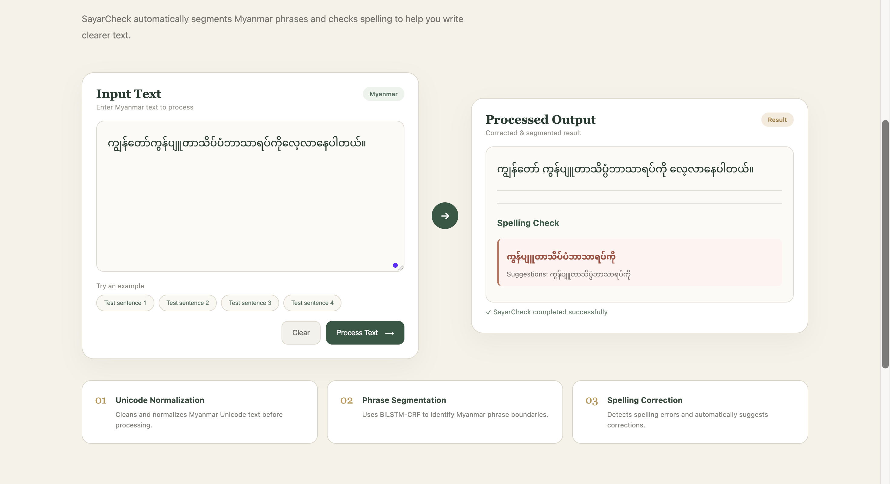

# Sayar Check:Myanmar NLP — Word Segmentation & Spelling Correction

A Myanmar Natural Language Processing (NLP) project combining deep learning, text preprocessing, and dictionary-based spelling correction in a Flask web application.

## Features

- **Myanmar Word Segmentation:** Uses a Bidirectional LSTM with a Conditional Random Field (BiLSTM-CRF) model to identify word boundaries.
- **Spelling Correction:** Uses SymSpell to find candidate spelling corrections based on word-frequency information.
- **Unicode Normalization:** Provides text normalization utilities for Myanmar text.
- **Syllable Tokenization:** Includes Myanmar syllable tokenization utilities.
- **Web Application:** A Flask-based interface built with HTML, CSS, and JavaScript.
- **Data Augmentation:** Includes scripts for generating augmented and spelling-related training data.
- **Model Training and Evaluation:** Includes training, prediction, and evaluation scripts.

## Screenshots

### SayarCheck — Homepage

The landing page introduces SayarCheck's Myanmar phrase segmentation and spelling-checking features.


### Myanmar Text Processing and Spelling Correction

An example of the application processing Myanmar text and displaying a spelling correction suggestion.



## Baseline Results

The following results are reported in `BASELINE_RESULT.txt`.

| Metric | Result |
|---|---:|
| Training examples | 489,719 |
| Validation examples | 54,414 |
| Official test examples | 28,639 |
| Best validation F1 | 0.9013 |
| Official test F1 | 0.9008 |
| Vocabulary size | 54,395 |

**Reported official test F1: 90.08%.**

These are the project's recorded baseline results, not a guarantee of performance on other datasets.

## Model Configuration

| Parameter | Value |
|---|---|
| Architecture | BiLSTM-CRF |
| Embedding dimension | 128 |
| LSTM hidden dimension | 128 |
| LSTM layers | 2 |
| Dropout | 0.3 |
| Optimizer | Adam |
| Learning rate | 0.001 |
| Training epochs | 3 |
| Maximum sequence length | 256 |

## Dataset

The project uses the [Myanmar Text Segmentation Dataset](https://huggingface.co/datasets/chuuhtetnaing/myanmar-text-segmentation-dataset) from Hugging Face for dataset loading and processing.

## Tech Stack

- **Language:** Python
- **Web framework:** Flask
- **Deep learning:** PyTorch
- **Sequence model:** BiLSTM-CRF
- **Spelling correction:** SymSpellPy
- **Dataset loading:** Hugging Face Datasets
- **Frontend:** HTML, CSS, JavaScript

## Project Structure

```text
myanmar_nlp_project/
├── app.py
├── train.py
├── predict.py
├── spelling_checker.py
├── build_spelling_dictionary.py
├── preprocessing/
│   ├── syllable_tokenizer.py
│   ├── unicode_normalizer.py
│   ├── vocabulary.py
│   └── vocab.json
├── models/
│   ├── bilstm_crf.py
│   └── dataset.py
├── augmentation/
├── frontend/
│   ├── index.html
│   ├── script.js
│   └── style.css
├── requirements.txt
└── BASELINE_RESULT.txt
```

## Getting Started

### Prerequisites

- Python 3
- pip
- Git

### 1. Clone the repository

```bash
git clone https://github.com/ad0rab0nb0n/Myanmar-NLP-Project.git
cd Myanmar-NLP-Project
```

### 2. Create and activate a virtual environment

```bash
python3 -m venv .venv
source .venv/bin/activate
```

### 3. Install dependencies

```bash
python -m pip install --upgrade pip
pip install -r requirements.txt
```

### 4. Generate the spelling dictionary

```bash
python build_spelling_dictionary.py
```

This script loads the dataset and generates `preprocessing/spelling_dictionary.json`.

### 5. Train the segmentation model

```bash
python train.py
```

Training downloads and processes the dataset and saves model checkpoints locally. Training time depends on available hardware.

### 6. Run the web application

The application requires the trained checkpoint at `checkpoints/best_model.pt` and the generated spelling dictionary at `preprocessing/spelling_dictionary.json`.

After these files are available, run:

```bash
python app.py
```

Open [http://127.0.0.1:5000/](http://127.0.0.1:5000/) in your browser if the application starts on the default Flask port.

## Model Artifacts

Large generated files, including trained checkpoints and the spelling dictionary, are excluded from the Git repository.

Generate these files locally before running the complete application. The repository does not automatically download the trained checkpoint.

## Project Goal

This project explores Myanmar language processing through neural word segmentation, Unicode normalization, syllable tokenization, and dictionary-based spelling correction.

---

Developed as a Myanmar NLP project using Python, PyTorch, and Flask.
